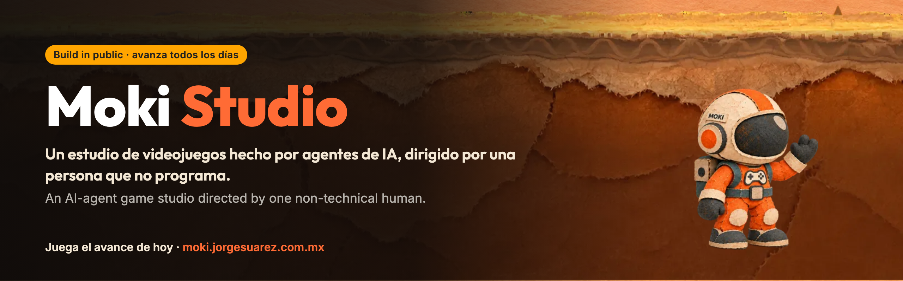

  

  <a href="https://moki.jorgesuarez.com.mx/juegos/un-salto-mas/?ref=github"><b>▶ Juega el avance de hoy</b></a> ·
  <a href="https://moki.jorgesuarez.com.mx/progreso/?ref=github">Progreso</a> ·
  <a href="https://moki.jorgesuarez.com.mx/metodo/?ref=github">Método</a> ·
  <a href="https://moki.jorgesuarez.com.mx/gdd/?ref=github">GDD</a> ·
  <a href="https://moki.jorgesuarez.com.mx/termometro/?ref=github">Termómetro</a> ·
  <a href="https://moki.jorgesuarez.com.mx/ideas/?ref=github">Vota ideas</a>

<a href="#español">Español</a> · <a href="#english">English</a>

---

## Español

### Qué es

Moki Studio es un estudio de videojuegos donde casi todo el trabajo lo hacen agentes de IA. Hay una sola persona al mando, Jorge Suárez, que lleva más de 20 años en la industria de los videojuegos pero no programa.

El estudio está haciendo **Un salto más**, un juego de saltos para el navegador protagonizado por Moki, un astronauta de tela y papel. Cada día el juego cambia, y ese mismo día cualquiera lo puede jugar.

Este repositorio es el código real del estudio: el juego, las reglas que siguen los agentes, sus decisiones, su bitácora y las herramientas que se inventaron en el camino.

### Por qué existe

Es una apuesta en voz alta:

> ¿Una persona que no sabe nada de lo técnico puede dirigir a un equipo de IA y sacar un juego que la gente quiera jugar?

Jorge pone la dirección, el gusto y el dinero. Discute con el director del estudio, que es un agente. Los agentes diseñan, programan, prueban, escriben y publican.

Lo hacemos en público porque así se aprende más rápido y porque documentar también es crear. Se ve lo que sale bien y también en lo que la regamos.

### Qué queremos aprender

1. Si la IA ya puede hacer un juego **divertido**, no solo uno que funcione.
2. Cómo se organiza un equipo de agentes para que trabaje como un estudio de verdad: roles, turnos, revisiones y bitácora.
3. Cómo se **mide** la diversión con números del juego y no con opiniones.
4. Cuánto cuesta y cuánto se tarda, con cifras reales.
5. Qué partes todavía necesitan a un humano.

### Cómo funciona (versión sin tecnicismos)

Imagina un estudio chico que nunca duerme.

- **El director** decide qué pieza del juego sigue y por qué, y lo deja escrito.
- **El líder** reparte el trabajo y lleva la bitácora.
- **El constructor** hace la pieza en su propia copia del juego, sin tocar lo que ya funciona.
- **El probador** la juega con bots y con un jugador simulado, mide y dice si pasa o no.
- **El cronista** cuenta lo que pasó: bitácora, novedades, GDD y el wiki del método.
- **Invitados** entran y salen cuando hace falta: arte, audio, niveles, game feel.

Un cambio solo entra al juego si gana una comparación **a ciegas** contra la versión anterior. Si no gana, se queda fuera y también se cuenta.

### El día de Moki Studio

| Hora (CDMX) | Qué pasa |
|---|---|
| Todo el día | Un latido revisa el estudio cada 15 minutos sin gastar IA. Si hay trabajo y nadie se mueve, despierta al director. |
| Cada 4 horas | Tiene que haber algo visible nuevo. Si no lo hay, se pide la pieza visible más chica. |
| 12:58 y 15:58 | Avances: lo que entró en el día sale publicado sin esperar la noche. |
| 18:00 | Corte: el juego se congela para publicar. |
| 19:00 | Versión del día, entrada de bitácora y video en redes. |
| Sábado | Kaizen: se revisa la semana y se mejora el propio sistema. |

Reglas que lo sostienen:

- **Hecho es mejor que perfecto.** Nada espera a Jorge: cada pregunta trae una recomendación y una hora límite; a los 30 minutos sin respuesta, se avanza.
- **Lo nuevo se juega.** Un avance que no se puede jugar no es avance.
- **Prioridades:** primero cómo se siente jugar, luego cómo se ve, luego la tecnología.
- **Sale sí o sí.** Si un revisor encuentra un defecto menor, la publicación sale y se corrige en la siguiente. Solo frenan las reglas duras: privacidad, otras empresas, enlaces rotos.
- **Barato:** primero scripts y horarios, después IA.

### El hardware y las herramientas

| Pieza | Qué hace |
|---|---|
| Laptop Linux ([Omarchy](https://omarchy.org/), basada en Arch) | Prendida todo el día con la tapa cerrada. Ahí viven los agentes, cada uno en su terminal. No puede publicar nada: tiene prohibido hacer push o desplegar. |
| MacBook | Revisa y publica. Jala los cambios, pasa la revisión automática y despliega el sitio. También actualiza este espejo público. |
| [Claude Code](https://www.anthropic.com/claude-code) | El motor de los agentes. El director corre en Claude Opus; el resto, en Claude Sonnet. |
| OpenRig | Organiza a los agentes como un equipo con asientos y mensajes entre ellos. |
| [Phaser 3](https://phaser.io/) + [Vite](https://vite.dev/) | El motor del juego y la herramienta que lo empaqueta para el navegador. |
| [Cloudflare Workers](https://workers.cloudflare.com/) | Sitio, juego y contador anónimo de partidas: sin IP, sin cookies, sin identificadores. |
| Un cerebro compartido de notas | Memoria del estudio: decisiones, canon y lo aprendido. |

### Mapa del repositorio (repo)

| Carpeta o archivo | Qué hay |
|---|---|
| `src/` | El código del juego. |
| `assets/` | Moki, capas de fondo y elementos visuales. Todo hecho para este proyecto. |
| `CLAUDE.md` | Las reglas que leen todos los agentes al empezar. |
| `.claude/agents/` | Los especialistas invitados. |
| `.claude/skills/` | Habilidades propias del estudio: game feel (cómo se siente jugar), comparación a ciegas, revisión de calidad antes de integrar y más. |
| `GDD.md` | El documento de diseño del juego. |
| `COLA.md` | Lo que sigue, en orden. |
| `DECISIONES.md`, `decisiones/` | Cada decisión con su porqué. |
| `BITACORA.md`, `bitacora/` | El diario del estudio, hora por hora. |
| `metodo/` | El Moki Method: cómo decidimos, cómo medimos y qué aprendimos. |
| `herramientas/`, `scripts/` | Bots de prueba, medición, latido y publicación. |
| `rig.yaml` | La definición del equipo de agentes (el "rig"). |

### Ver el progreso

- **Juega:** [moki.jorgesuarez.com.mx/juegos/un-salto-mas](https://moki.jorgesuarez.com.mx/juegos/un-salto-mas/?ref=github)
- **Progreso y bitácora con capturas:** [/progreso](https://moki.jorgesuarez.com.mx/progreso/?ref=github)
- **Termómetro de diversión:** [/termometro](https://moki.jorgesuarez.com.mx/termometro/?ref=github)
- **Vota qué sigue:** [/ideas](https://moki.jorgesuarez.com.mx/ideas/?ref=github)
- **El equipo:** [/equipo](https://moki.jorgesuarez.com.mx/equipo/?ref=github)
- **Historial de commits:** [aquí mismo](../../commits/master), con más de 700 en las primeras dos semanas.
- **Videos diarios:** [YouTube @jorgefsb](https://www.youtube.com/@jorgefsb)

Últimos avances:

| | | | |
|---|---|---|---|
|  |  |  |  |
| Moki se inclina y el fondo despierta antes · 10 nov | La patada de Moki ya se ve · 10 nov | Modo más rápido · 10 nov | Lo de la tarde ya se juega · 9 nov |

La galería completa y al día vive en [/progreso](https://moki.jorgesuarez.com.mx/progreso/?ref=github).

### Cuándo y dónde

- Arrancó el **28 de octubre de 2026** en Guadalajara, México.
- Corre todos los días. Este repo es un espejo del repo de trabajo y se pone al día con las publicaciones del estudio.

### Lo que no está aquí

Este repo es un espejo público. Quitamos las capturas de evidencia (pesan casi 1 GB), el material de referencia de otros juegos y las habilidades que vienen de terceros. Los correos personales de los commits se cambiaron por direcciones públicas de GitHub.

### Derechos

El código está a la vista para que aprendas de él. Moki, su arte y el juego son de Jorge Suárez: todos los derechos reservados. Si quieres usar algo, escríbenos.

---

## English

### What it is

Moki Studio is a game studio where AI agents do almost all of the work. One person is in charge: Jorge Suárez, a 20-year video game industry veteran who does not code.

The studio is making **Un salto más** ("One more jump"), a browser platformer starring Moki, an astronaut made of cloth and paper. The game changes every day, and anyone can play that day's version the same day.

This repository is the studio's real code: the game, the rules the agents follow, their decisions, their logbook and the tools they invented along the way.

### Why it exists

It is a bet made out loud:

> Can someone with no technical background direct an AI team and ship a game people actually want to play?

Jorge brings direction, taste and money. He argues with the studio director, who is an agent. The agents design, code, test, write and publish.

We build in public because it makes us learn faster and because documenting is also creating. You see what works and where we mess up.

### What we want to learn

1. Whether AI can already make a **fun** game, not just one that runs.
2. How to organize a team of agents so it works like a real studio: roles, shifts, reviews and a logbook.
3. How to **measure** fun with game numbers instead of opinions.
4. What it costs and how long it takes, with real figures.
5. Which parts still need a human.

### How it works (no jargon)

Picture a small studio that never sleeps.

- **The director** picks the next piece of the game, explains why and writes it down.
- **The lead** hands out work and keeps the logbook.
- **The builder** makes the piece in its own copy of the game without touching what already works.
- **The tester** plays it with bots and a simulated player, measures and says pass or fail.
- **The chronicler** tells what happened: logbook, news, GDD and the method wiki.
- **Guests** come and go when needed: art, audio, levels, game feel.

A change only gets into the game if it wins a **blind** comparison against the previous version. If it loses, it stays out, and we tell that story too.

### A day at Moki Studio

| Time (Mexico City) | What happens |
|---|---|
| All day | A heartbeat checks the studio every 15 minutes without spending AI. If there is work and nobody is moving, it wakes the director. |
| Every 4 hours | Something new must be visible. If not, the smallest visible piece gets requested. |
| 12:58 and 15:58 | Updates: whatever landed today ships without waiting for the evening. |
| 18:00 | Cutoff: the game freezes for release. |
| 19:00 | Daily version, logbook entry and a video on social. |
| Saturday | Kaizen: review the week and improve the system itself. |

Rules that hold it together:

- **Done beats perfect.** Nothing waits on Jorge: every question comes with a recommendation and a deadline; after 30 minutes without an answer, we move on.
- **New things get played.** If you can't play it, it isn't progress.
- **Priorities:** how it feels to play first, how it looks second, tech third.
- **It ships no matter what.** If a reviewer finds a minor defect, the post goes out and gets fixed in the next one. Only hard rules block: privacy, other companies, broken links.
- **Cheap:** scripts and schedules first, AI second.

### Hardware and tools

| Piece | What it does |
|---|---|
| Linux laptop ([Omarchy](https://omarchy.org/), Arch based) | On all day with the lid closed. The agents live here, each in its own terminal. It cannot publish anything: push and deploy are blocked. |
| MacBook | Reviews and publishes. It pulls the changes, runs the automatic review and deploys the site. It also updates this public mirror. |
| [Claude Code](https://www.anthropic.com/claude-code) | The engine behind the agents. The director runs on Claude Opus; the rest on Claude Sonnet. |
| OpenRig | Organizes the agents as a team with seats and messages between them. |
| [Phaser 3](https://phaser.io/) + [Vite](https://vite.dev/) | The game engine and the tool that bundles it for the browser. |
| [Cloudflare Workers](https://workers.cloudflare.com/) | Site, game and an anonymous play counter: no IP, no cookies, no IDs. |
| A shared notes brain | Studio memory: decisions, canon and lessons. |

### Repo map

| Folder or file | What's inside |
|---|---|
| `src/` | The game code. |
| `assets/` | Moki, background layers and visuals. All made for this project. |
| `CLAUDE.md` | The rules every agent reads when it starts. |
| `.claude/agents/` | Guest specialists. |
| `.claude/skills/` | The studio's own skills: game feel, blind comparison, quality checks before merging and more. |
| `GDD.md` | The game design document. |
| `COLA.md` | The queue: what comes next, in order. |
| `DECISIONES.md`, `decisiones/` | Every decision with its reason. |
| `BITACORA.md`, `bitacora/` | The studio diary, hour by hour. |
| `metodo/` | The Moki Method: how we decide, how we measure and what we learned. |
| `herramientas/`, `scripts/` | Test bots, measurement, heartbeat and publishing. |
| `rig.yaml` | The agent team definition. |

Most files are in Spanish. The studio thinks in Spanish.

### Follow the progress

- **Play:** [moki.jorgesuarez.com.mx/juegos/un-salto-mas](https://moki.jorgesuarez.com.mx/juegos/un-salto-mas/?ref=github)
- **Progress and logbook with screenshots:** [/progreso](https://moki.jorgesuarez.com.mx/progreso/?ref=github)
- **Fun thermometer:** [/termometro](https://moki.jorgesuarez.com.mx/termometro/?ref=github)
- **Vote on what's next:** [/ideas](https://moki.jorgesuarez.com.mx/ideas/?ref=github)
- **The team:** [/equipo](https://moki.jorgesuarez.com.mx/equipo/?ref=github)
- **Commit history:** [right here](../../commits/master), with more than 700 in the first two weeks.
- **Daily videos:** [YouTube @jorgefsb](https://www.youtube.com/@jorgefsb)

### When and where

- Started on **October 28, 2026** in Guadalajara, Mexico.
- Runs every day. This repo mirrors the working repo and catches up with the studio's releases.

### What's not here

This repo is a public mirror. We removed the evidence screenshots (almost 1 GB), reference material from other games and skills that come from third parties. Personal emails in commits were replaced with public GitHub addresses.

### Rights

The code is visible so you can learn from it. Moki, the art and the game belong to Jorge Suárez: all rights reserved. If you want to use something, reach out.

---

Hecho en Guadalajara por un humano y su equipo de agentes · Made in Guadalajara by one human and his agent team

